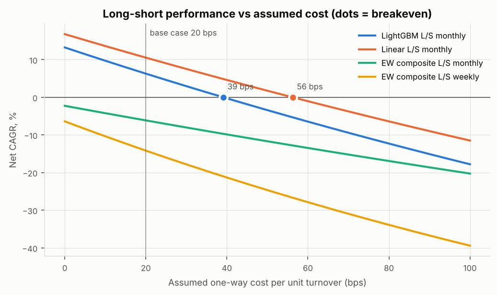

# Equity Factor Research & Systematic Backtest (NSE)

Cross-sectional factor research on ~200 NSE large and mid caps, 2015–2026:
a point-in-time liquidity universe in SQL, seven price/volume factors, signal
evaluation (rank IC, decay, decile monotonicity), a LightGBM ranking model under
purged and embargoed walk-forward CV, and a long-short decile backtest net of
transaction costs and turnover.

**Research note:** [`report/equity_factor_research.pdf`](report/equity_factor_research.pdf)

## Findings

| | |
|---|---|
| Strongest factors (monthly rank IC) | 12-1 momentum **0.034** (t 3.1), liquidity **−0.034** (t −3.8, illiquid outperform) |
| Contrary to the literature | low-volatility and idiosyncratic volatility had the "wrong" sign in 2016–2026 |
| LightGBM, out-of-sample 2019–2026 | IC **0.038** (t 3.7) vs 0.025 for an equal-weight composite; the difference is not significant (t 0.9). OLS does better (0.049) |
| Long-short decile book (LightGBM) | gross CAGR 13.2% (Sharpe 0.98) → **net 6.3% (Sharpe 0.51, Sortino 0.73, max DD −34%)** at 20 bps |
| Cost breakeven | 39 bps (LightGBM), 56 bps (linear); turnover 2.6× NAV per monthly rebalance |
| Parameter sensitivity | LightGBM net Sharpe positive in **16/16** momentum × volatility lookback cells (0.22–1.29); the default sits at 0.51 |
| Multiple testing | 52 strategy variants scored; deflated-Sharpe probability 0.19 → **not significant after correction** |
| Most robust result | LightGBM top decile beat the equal-weight universe by 9.1%/yr (Sharpe 1.10 on the difference) |

Results are honest rather than flattering: the signal is real but small, ML adds
little over a linear model, and costs consume most of the long-short edge.



## Pipeline

```
prices.parquet, sectors.csv, corporate_actions.csv
  └─ src/build_db.py        SQLite: prices, sectors, trading_days, nifty_index (+ corporate-action fixes)
  └─ src/build_universe.py  runs sql/universe.sql: monthly top-200 by trailing 60d median traded value
  └─ src/factors.py         Phase 2: 7 factors, trailing windows only            -> factors_raw
  └─ src/preprocess.py      Phase 3: per-date winsorize 1/99, z-score, sector demean -> factors_z
  └─ src/evaluate.py        Phase 4: rank IC, t-stat, decay, deciles, correlation
  └─ src/model.py           Phase 5: LightGBM, purged + embargoed walk-forward     -> predictions
  └─ src/backtest.py        Phase 6: daily decile backtest, costs, turnover, cost sweep
  └─ src/sensitivity.py     Phase 7: lookback grid (full refit) and portfolio grid
  └─ src/risk.py            Phase 7: Sharpe, Sortino, max DD, Calmar, beta, variant ledger, deflated Sharpe
  └─ src/export_powerbi.py  Phase 8: star-schema CSVs for Power BI (see powerbi/README.md)
  └─ src/report.py          Phase 8: research note PDF (numbers read from results/)
```

```bash
pip install -r requirements.txt
python src/run_all.py      # ~30 min, most of it the 16-cell sensitivity grid
python -m pytest tests     # look-ahead, purging, engine and metric tests
```

## Design decisions

- **Survivorship.** The universe is rebuilt each month from data available at that date
  (liquidity rank), never from today's index membership. The candidate list is still
  today's Nifty 200, so delisted names are missing. This inflates long-only returns
  (the equal-weight universe made 26%/yr vs 10.7% for the Nifty 50) and is documented, not hidden.
- **No look-ahead.** Factors are trailing windows ending at t; a test appends future
  data and checks past values are unchanged. Cross-sectional statistics are computed
  per date only. Trades execute at close t+1.
- **Pre-registered signs.** The expected sign of each factor was committed
  (`src/common.py`) before any IC was computed, and used to orient the composite.
- **Purging and embargo.** 21-day labels overlap across samples, so training samples
  whose label window overlaps the test block are purged, and inner-CV folds add a
  5-day embargo. Shuffled-label runs give out-of-sample IC −0.0003 ± 0.010.
- **Corporate actions.** Unadjusted bonuses and demergers in the Yahoo data were found
  by screening and fixed in `corporate_actions.csv` (two could not be verified).
- **Variant count.** Every configuration evaluated is logged in `results/variants.csv`.

## Limitations

Survivorship in the candidate list; static sector labels; flat bps costs without
market impact or borrow fees; Nifty 50 benchmark is a price index; one market, one decade.
